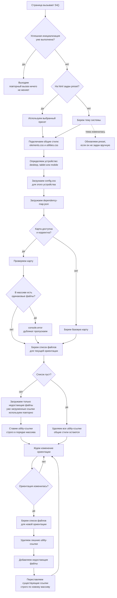

# Как работает S4()

Файл: `src/js/s4.js`.

## Коротко

- `elements.css` и `utilities.css` подключаются всегда.
- `config.css` зависит от устройства: desktop, tablet или mobile.
- Файлы `*-utilities.css` берутся из `dependency-map.json` для текущей пары устройство + ориентация.
- Порядок utility-ссылок всегда совпадает с порядком массива в карте.
- При смене ориентации существующие ссылки переставляются, а не создаются заново.
- Если массив пуст, удаляются все device/orientation utility-ссылки, но общие стили остаются.
- Если в массиве есть дубликат, выводится `console.error`, повтор не загружается.

## Схема

## Что важно

- Устройство определяется при запуске и не меняется. При изменении размеров окна меняется ориентация.
- При смене ориентации меняется только набор utility-файлов: `elements.css`, `utilities.css` и `config.css` остаются на месте.
- Если карта не загрузилась или сломана, используется встроенная базовая карта.
- Если массив для текущей ориентации пуст, utility-файлы не подключаются, но базовые стили и `config.css` продолжают работать.
- Если изменить порядок файлов в массиве карты, изменится и порядок каскада CSS.
